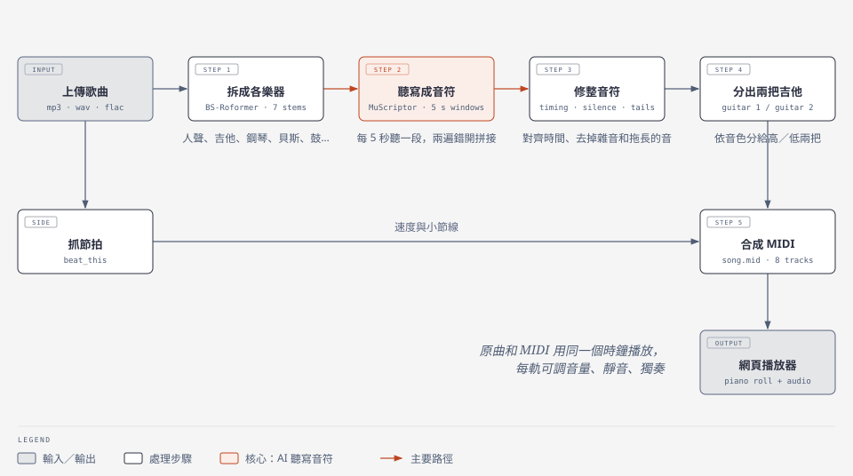

# stemscribe

Turn a song into multitrack MIDI (lead / backing vocals, bass, drums, piano, two guitars, other) and play it back in the browser next to the original.



Personal, non-commercial use: the MuScriptor and BS-Roformer-SW weights are CC BY-NC.

## Setup

You need Python 3.11, [uv](https://docs.astral.sh/uv/), `ffmpeg` on the PATH, and an NVIDIA GPU.

Each stage runs in its own venv under `envs/`. Create one per file in `requirements/`:

```
for name in beat_this separator muscriptor tools; do
  uv venv envs/$name --python 3.11
  uv pip install --python envs/$name/Scripts/python.exe -r requirements/$name.txt \
      --extra-index-url https://download.pytorch.org/whl/cu128
done
```

On Linux or macOS, use `envs/$name/bin/python`. On Windows, set `PYTHONIOENCODING=utf-8`.

Model weights download to `envs/models/` the first time they are used. The two-guitar splitter is the exception: it is trained locally (see below) and is expected at `envs/models/guitar_split_run5_gap/best.pt`.

## Use it

**Web UI** (recommended)

```
python server.py            # open http://localhost:8000
```

1. Click **上傳歌曲** and pick an audio file. Progress shows in the left list; a 4-minute song takes a few minutes.
2. Click the finished song. Each track gets its own lane.
3. **Space** plays or pauses. Click the roll to jump. Scroll to move, and Ctrl+scroll to zoom.
4. Use the sliders for overall volume, the balance between the original and the MIDI, and per-track volume. **M** mutes a track and **S** solos it.
5. Download `song.mid`.

**Command line**

```
python run.py song.mp3
```

The result is `work/<song_id>/02_midi/bs_roformer_sw_dry_win_refined_modelassign/song.mid`. Steps that already finished are skipped on re-runs. To redo some of them, pass `--force transcribe,merge`.

## Layout

```
run.py, server.py   entry points: command line / web UI
pipeline/           one script per stage (run by run.py, each in its venv) + their self-checks
training/           two-guitar splitter training
web/                browser UI (plain JS modules, no build)
work/<song_id>/     all outputs (git-ignored)
```

## Development

- Tests live in `tests/`. Run `envs/tools/Scripts/python.exe -m pytest`; the training test needs torch, so run it with `envs/separator/Scripts/python.exe -m pytest` (it is skipped elsewhere).
- Lint: `envs/tools/Scripts/ruff.exe check .` (config in `pyproject.toml`). CI runs lint and tests on every push.
- Two-guitar splitter: `training/fetch_slakh_full.py` downloads Slakh2100 to `dataset/slakh_flac/`. Then train with `envs/separator/Scripts/python.exe training/train_guitar_split.py 10`.
